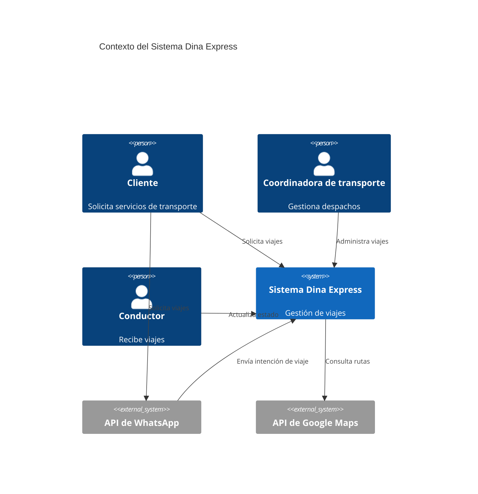
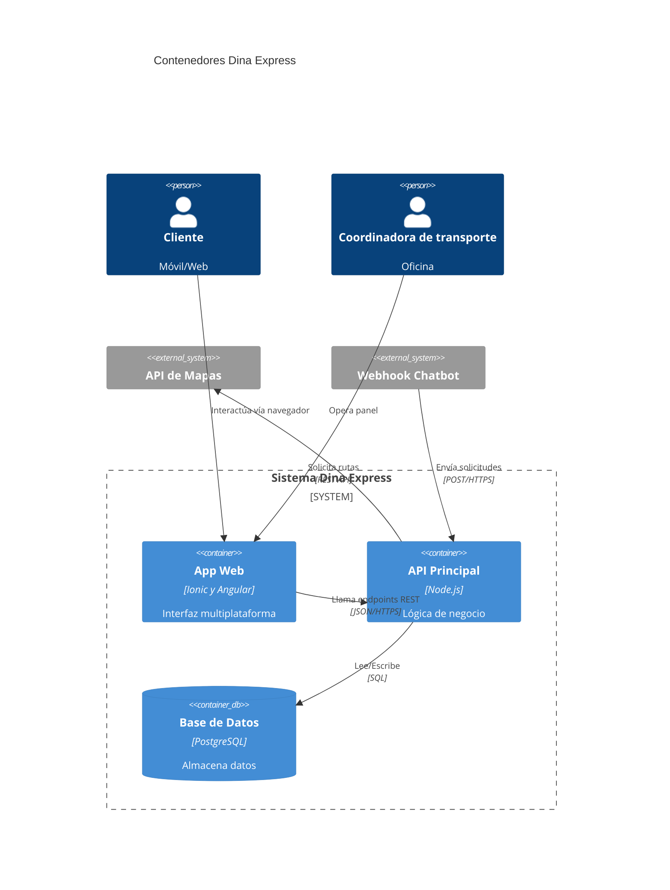

# Documento de diseño y ADR (módulo 3)

Sistema web de solicitud y gestión de servicios de transporte (Dina Express). Versión 3.0, 31 de octubre de 2026.

> **Sobre esta versión:** se quitaron los nombres propios, las capturas y los ejercicios de clase sobre otro sistema (un minimercado). El diseño se conserva como se aprobó entonces. **Lo construido después difiere en varios puntos** (por ejemplo, no hay chatbot, WhatsApp ni mapas, y el cuerpo de `POST /viajes` es otro).

## 1. Contexto y atributos de calidad

Plataforma B2C para gestionar servicios de transporte ocasionales. Permite a los clientes solicitar viajes (vía web o chatbot) y a la coordinadora de transporte despachar, monitorear y administrar las solicitudes y los conductores disponibles.

| Atributo de calidad | Peso | Apoyo en los requisitos |
|---|---|---|
| Disponibilidad | 5 | El sistema debe estar en línea 24/7 para recibir solicitudes web y de chatbot sin perder viajes (N-07). |
| Usabilidad | 5 | Los clientes finales necesitan una interfaz sencilla desde celulares pequeños (RNF-02). |
| Rendimiento | 4 | La asignación de conductores y actualización de estados deben reflejarse rápido (RNF-03). |
| Seguridad | 4 | Protección de datos de clientes y control estricto de edición comercial (RNF-01). |

## 2. Alternativas y matriz ponderada

- **A. Monolito en la nube con Ionic y Angular:** frontend en Ionic/Angular para facilitar una futura app móvil, backend en Node.js y base de datos relacional en una plataforma en la nube.
- **B. Microservicios:** varios servicios independientes orquestados con Kubernetes.
- **C. Aplicación local (on-premise):** servidor físico en la oficina de Dina Express.

| Atributo | Peso | A (monolito) | B (micro) | C (local) |
|---|---|---|---|---|
| Disponibilidad | 5 | 5 | 5 | 2 |
| Usabilidad | 5 | 5 | 4 | 4 |
| Rendimiento | 4 | 4 | 5 | 3 |
| Seguridad | 4 | 4 | 4 | 2 |
| **Total ponderado** | | **82** | **81** | **50** |

**Decisión:** elegimos la Alternativa A porque garantiza una excelente usabilidad en celulares y deja la puerta abierta para compilar una app nativa a futuro, reduciendo la complejidad de despliegue, y sacrificamos la escalabilidad extrema de los microservicios.

## 3. Diagramas C4

### 3.1 Contexto

Qué corregí del borrador de la IA: aclaré el nombre de la coordinadora (omitido en esta versión) y definí flujos directos de los actores hacia el sistema central.

### 3.2 Contenedores

Qué corregí del borrador de la IA: cambié el framework frontend a Ionic y Angular para cumplir con la proyección multiplataforma y conecté el webhook de WhatsApp.

## 4. ADR-001. Arquitectura monolítica en la nube con frontend Ionic/Angular

- **Estado:** aceptada.
- **Contexto:** Dina Express requiere una plataforma B2C muy ágil desde celulares (RNF-02). La coordinadora de transporte necesita controlar la operativa central 24/7. El equipo requiere tecnología que permita escalar hacia aplicaciones móviles nativas a futuro sin reescribir todo el código.
- **Decisión:** arquitectura web SPA con Ionic y Angular, backend monolítico en Node.js y PostgreSQL en la nube.
- **Alternativas consideradas:** (1) microservicios, descartada por excesiva carga de DevOps para el momento inicial; (2) servidor local, descartada por el alto riesgo de caída de red eléctrica que apagaría el sistema para los clientes externos (N-07).
- **Consecuencias positivas:** reutilización de código para una futura app móvil, bajo costo inicial.
- **Consecuencias negativas:** ligero acoplamiento en el backend que podría requerir refactorización si el volumen de solicitudes por WhatsApp crece exponencialmente.
- **Uso de IA:** la IA propuso React y Angular. Elegí Ionic/Angular explícitamente por la facilidad de empaquetado móvil híbrido.

## 5. Modelo de datos

| Entidad | Atributos (PK y FK) | Relaciones y cardinalidad |
|---|---|---|
| Cliente | id_cliente PK, nombre, telefono, email | Cliente 1 a N Viaje |
| Conductor | id_conductor PK, nombre, licencia, telefono, estado | Conductor 1 a N Viaje |
| Vehiculo | id_vehiculo PK, placa, marca, modelo, id_conductor FK | Vehiculo N a 1 Conductor |
| Viaje | id_viaje PK, fecha_hora, origen, destino, tarifa, estado, id_cliente FK, id_conductor FK | Viaje N a 1 Cliente; Viaje N a 0..1 Conductor |
| Pago | id_pago PK, id_viaje FK, monto, metodo, estado | Pago 1 a 1 Viaje |

## 6. API diseñada

| Método | Ruta | Historia | Cuerpo de ejemplo | Códigos de estado |
|---|---|---|---|---|
| POST | /viajes | HU-01 | {"origen": "Calle 4", "destino": "Centro", "id_cliente": 12} | 201 Creado; 400 Inválido |
| GET | /viajes/pendientes | HU-05 | No aplica | 200 Éxito (lista); 401 No autorizado |
| PUT | /viajes/{id}/asignar | HU-04 | {"id_conductor": 5} | 200 OK; 409 Ocupado |
| PUT | /viajes/{id}/estado | HU-05 | {"estado": "en_curso"} | 200 OK; 400 Estado inválido |
| GET | /conductores/disponibles | HU-03 | No aplica | 200 Éxito |

## 7. Uso de IA: registro de prompts

### Prompt 1. Alternativas de arquitectura (Claude 3.5 Sonnet / ChatGPT)
- **Prompt:** «Actúa como un arquitecto de software. Para un sistema de transporte como Dina Express, donde los clientes piden viajes online y una coordinadora los despacha, propón 3 alternativas arquitectónicas. Incluye matriz ponderada con Disponibilidad, Usabilidad y Rendimiento.»
- **Respuesta:** propuso Monolito, Microservicios y Serverless. Presentó la matriz y sugirió Microservicios para escalar.
- **Qué verifiqué:** que las opciones fueran coherentes para un entorno web transaccional y soportaran integraciones externas.
- **Problemas:** recomendaba Microservicios desde el día 1, sobreingeniería para un proyecto que apenas va a salir al mercado.
- **Qué corregí:** elegí el monolito en la nube en el ADR, por el tamaño del equipo, los costos y la facilidad de despliegue inicial.

### Prompt 2. Diagramas C4 en Mermaid (ChatGPT)
- **Prompt:** «Genera el diagrama C4 de contexto y contenedores en sintaxis Mermaid para un Monolito Web de transporte. Incluye al Cliente, la Coordinadora, el Conductor y dependencias de Google Maps y WhatsApp.»
- **Respuesta:** dos scripts en Mermaid.
- **Qué verifiqué:** que las flechas tuvieran el sentido correcto y los nombres de los actores coincidieran con la entrevista.
- **Problemas:** el nombre de la coordinadora estaba mal y olvidó la tecnología del frontend en el contenedor.
- **Qué corregí:** puse el nombre correcto (omitido en esta versión), definí Ionic/Angular como contenedor frontend y ajusté las flechas del webhook de WhatsApp.

### Prompt 3. Modelo de datos (ChatGPT)
- **Prompt:** «Diseña las entidades principales para la base de datos de Dina Express (Cliente, Conductor, Viaje). Define llaves primarias, foráneas y relaciones de cardinalidad.»
- **Respuesta:** tablas con Viaje como pivote central. Sugirió agregar Pago y Vehículo.
- **Qué verifiqué:** que la relación entre Viaje y Conductor permitiera un conductor nulo inicialmente.
- **Problemas:** puso relación obligatoria (1 a 1) entre Viaje y Conductor, lo que bloqueaba los viajes pendientes.
- **Qué corregí:** la cardinalidad a «Viaje N a 0..1 Conductor».

### Prompt 4. Endpoints REST (ChatGPT)
- **Prompt:** «Redacta 5 endpoints RESTful para la gestión operativa de Dina Express (crear viaje, ver pendientes, asignar conductor, cambiar estado). Muestra Método, Ruta, Cuerpo JSON y Códigos HTTP.»
- **Respuesta:** una tabla con métodos y rutas.
- **Qué verifiqué:** principios REST (sustantivos, sin verbos).
- **Problemas:** verbos en las URL (por ejemplo, /asignarConductor).
- **Qué corregí:** rutas basadas en recursos, como PUT /viajes/{id}/asignar.

## Resumen

- **Qué propuso la IA:** arquitecturas avanzadas como Serverless y Microservicios, y React para el frontend inicial.
- **Qué descarté y por qué:** Microservicios por sobreingeniería y React para priorizar Ionic/Angular, buscando la base multiplataforma que facilite una futura app nativa para los conductores.
- **Errores que encontré:** los diagramas C4 traían el nombre equivocado de la coordinadora y el modelo de datos obligaba a tener un conductor asignado desde la creación del viaje.
- **Decisiones mías:** arquitectura monolítica con Ionic/Angular, corrección del nombre, cardinalidad N a 0..1 para permitir viajes pendientes y servidor en la nube (PaaS).
